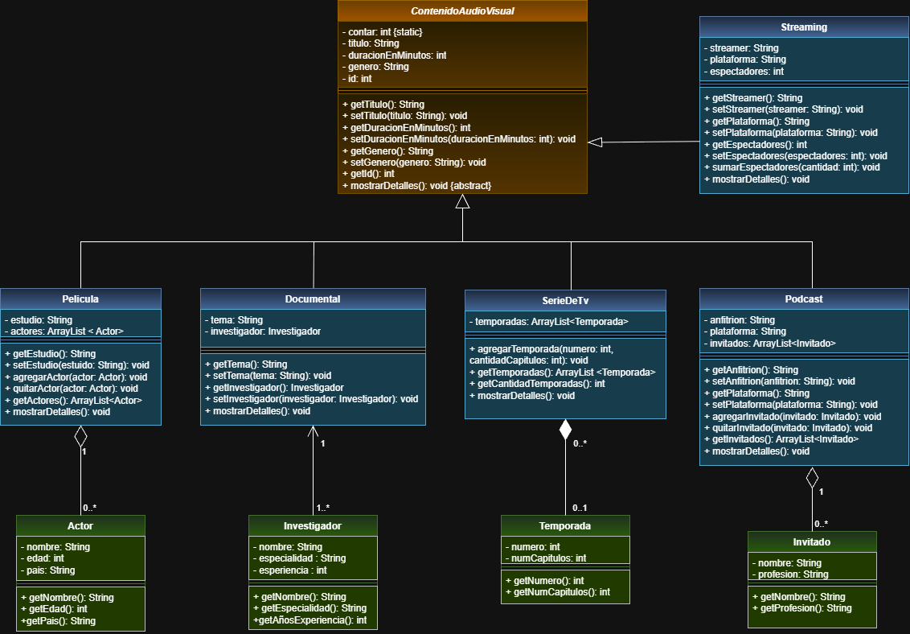

# Proyecto POO: Contenido Audiovisual

Proyecto de la materia Programacion Orientada a Objetos  

Universidad Politecnica Salesiana, Unidad 2: Relacion entre clases.

**Autor:** Alejandro Granda

## Objetivo y proposito

Ampliar un proyecto en Java que modela contenido audiovisual, aplicando herencia, asociacion, agregacion y composicion. Este codigo permite crear y manipular distintos tipos de contenido (peliculas, series, documentales, podcasts y transmisiones en vivo) junto con las clases relacionadas a cada uno.

## Clases del proyecto

**Clases originales:** `ContenidoAudiovisual` (clase abstracta), `Pelicula`, `SerieDeTV` y `Documental`.

**Clases y funcionalidades nuevas:**

| Clase | Relación | Descripción |
|---|---|---|
| `Actor` | Agregacion con `Pelicula` | Una pelicula tiene una lista de actores creados independientemente (`agregarActor`, `quitarActor`). |
| `Temporada` | Composicion con `SerieDeTV` | La serie crea sus propias temporadas por dentro (`agregarTemporada`). |
| `Investigador` | Asociacion con `Documental` | El documental guarda la referencia a un investigador (`setInvestigador`). |
| `Podcast` | Hereda de `ContenidoAudiovisual` | Tiene anfitrion, plataforma y una lista de invitados dependiendo un caso en especifico. |
| `Invitado` | Agregacion con `Podcast` | Persona que se lo invita a un podcast (nombre y profesion). |
| `Streaming` | Hereda de `ContenidoAudiovisual` | Transmision en vivo con streamer, plataforma y espectadores (`sumarEspectadores`). |

Todas las subclases sobrescriben el metodo abstracto `mostrarDetalles()`.

## Diagrama de clases



## Estructura del repositorio

```
src/
├── poo/
│   └── PruebaAudioVisual.java
└── uni1a/
    ├── ContenidoAudiovisual.java
    ├── Pelicula.java
    ├── SerieDeTV.java
    ├── Documental.java
    ├── Podcast.java
    ├── Streaming.java
    ├── Actor.java
    ├── Temporada.java
    ├── Investigador.java
    └── Invitado.java
```

## Cómo clonar y ejecutar

**Requisitos:** JDK 17 o superior y Eclipse (o cualquier IDE para Java).

1. Clonar el repositorio:
   ```
   git clone https://github.com/nexus-a11/poo_audiovisual.git
   ```
2. En Eclipse: **File > Import > General > Existing Projects into Workspace** y seleccionar la carpeta clonada.
3. Abrir `src/poo/PruebaAudioVisual.java`.
4. Clic derecho > **Run As > Java Application**.

La consola mostrara la informacion de los 6 objetos creados a partir de las clases creadas y al final las pruebas de los metodos de consulta.

## Mejoras adicionales

- Se corrigieron los textos de `mostrarDetalles()` en `SerieDeTV` y `Documental` se escribio "Detalles de la pelicula" ahora dice "serie" y "documental".
- **`SerieDeTV` mas completa:** antes guardaba solo un numero de temporadas (`int`) ahora guarda una lista de objetos `Temporada`, cada una con su numero y cantidad de capitulos respectivamente.
- La clase `PruebaAudioVisual` guarda todos los objetos en un arreglo de `ContenidoAudiovisual` y los recorre con un solo `for`, lo que nos da un ejemplo de polimorfismo.
- Se agrego una parte de pruebas de los metodos de consulta (`getCantidadTemporadas`, `getActores`, `getInvitados`, `getEspectadores`, `getInvestigador`).
- **Validacion de datos vacios:** si una pelicula no tiene actores, un podcast no tienen invitados o un documental no tiene investigador, nos mostrara un mensaje en lugar de dejar el espacio vacio o fallar con `null`.
- **Metodo propio en `Streaming`:** `sumarEspectadores()` nos da la opcion de actualizar la audiencia sin reemplazar el valor.
- **Polimorfismo:** `PruebaAudioVisual` guarda todos los contenidos en un arreglo de `ContenidoAudiovisual` y los recorre con un solo `for` que llama a `mostrarDetalles()`.
- Se agrego el diagrama de clases UML al repositorio.
